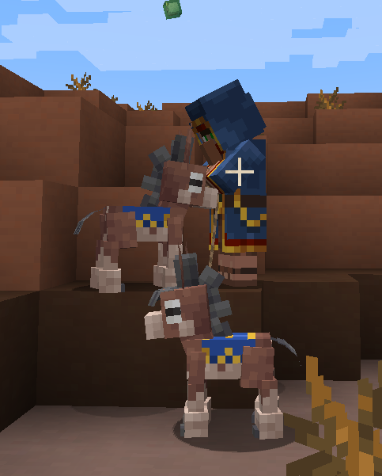
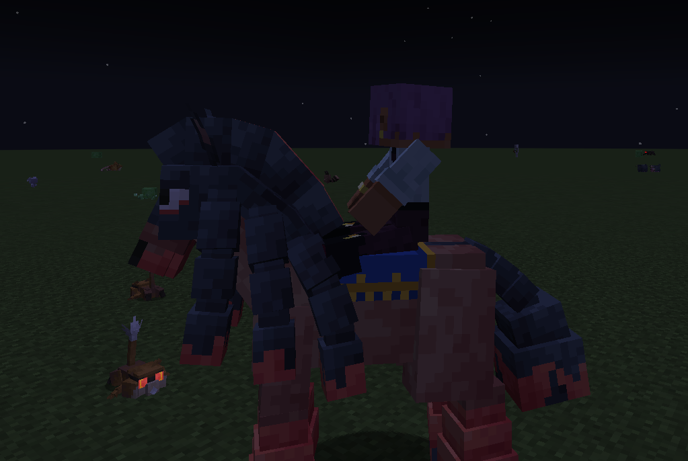

# Cobblemon Ecosystems

**Pokémon ecosystems for Cobblemon · Ecossistemas Pokémon para o Cobblemon**



<details>
<summary><b>🇺🇸 English</b></summary>

Pokémon are the animals — and the plants, and the creatures of the wild. This add-on removes vanilla animals and lets Pokémon take their place as the living fauna of Minecraft, sharing the world with villagers, traders and everything else. Hostile monsters and villagers stay.

### ✅ Implemented
- **No vanilla animals**: passive animals, hoglins and spiders no longer spawn, in every biome
- **Every source blocked**: spawn eggs, breeding, village cats, `/summon` and animals saved in old worlds
- **Editable removal list**: a data tag (`removed_animals`) you can change with a datapack
- **Villages with Pokémon**: pen and stable animals become Pokémon (Miltank, Tauros, Lechonk, Wooloo, Mareep, Ponyta, Mudbray, Numel, Meowth, Skitty, Purrloin, Espurr)
  - Same pen, same species
  - 20% chance of an evolved form
- **Wandering Trader**: arrives with two Mudbray on leads instead of llamas, wearing an exclusive trader blanket
- **Battle the trader**: sneak + right-click him, or send out a Pokémon at him or his Mudbray
  - While you battle, he stands still and hides his real Mudbray
  - Win and you can catch one of his Mudbray
- **Trader blanket as a unique look**: it stays after capture and on Mudsdale after evolving

### 🧪 Experimental (implemented, still being tested in game)
- **Golurk and Golett guard villages** instead of iron golems; iron golems can no longer be built with a pumpkin (snow golems still can)
- **Combee, Vespiquen, Cutiefly and Ribombee live in beehives**: they visit flowers, pollinate crops and fill the hive with honey
- **Villagers with Pokémon partners** matching their profession (and a Pichu riding on a villager's head!)
- **Dog Pokémon hunt skeletons**, and wild ones sometimes hunt wild sheep Pokémon

> Cat Pokémon scaring away creepers and phantoms, and skeletons fleeing from dog Pokémon, already come with Cobblemon itself.

### 🗺️ Planned
- Config file: choose to remove passive animals, hostile animals and/or slimes
- Pillagers, vindicators, witches and illusioners with their own Pokémon
- Dwebble hiding in infested blocks instead of silverfish
- Pasture farms: Spinarak webs, Charmander blaze powder, Solosis slime balls, eggs, honey
- Frog Pokémon and Slugma giving froglights
- **Flora**: Grass Pokémon tending crops, spreading mushrooms and living by the sun
- Wild Pokémon fighting back, predators and prey, day and night routines

The full checklist is in [ROADMAP.md](ROADMAP.md) (Portuguese).

### Requirements
- Minecraft 1.21.1 · NeoForge
- Cobblemon 1.8+
- Kotlin for Forge

### Notes
- Back up existing worlds: tamed vanilla pets (wolves, cats, horses) are removed when loaded
- Village Pokémon only appear in villages generated after installing the mod
- Iron farms stop working, since villagers no longer summon iron golems

</details>

<details>
<summary><b>🇧🇷 Português</b></summary>

Os Pokémon são os animais, e também as plantas e as criaturas selvagens. Este add-on remove os animais vanilla e deixa os Pokémon ocuparem o lugar deles como a fauna viva do Minecraft, convivendo com aldeões, mercadores e todo o resto. Monstros hostis e aldeões continuam.

### ✅ Pronto
- **Sem animais vanilla**: animais passivos, hoglins e aranhas não nascem mais, em nenhum bioma
- **Todas as fontes bloqueadas**: ovos de spawn, reprodução, gatos de vila, `/summon` e animais salvos em mundos antigos
- **Lista de remoção editável**: uma tag (`removed_animals`) que pode ser mudada por datapack
- **Vilas com Pokémon**: animais dos currais e estábulos viram Pokémon (Miltank, Tauros, Lechonk, Wooloo, Mareep, Ponyta, Mudbray, Numel, Meowth, Skitty, Purrloin, Espurr)
  - Mesmo cercado, mesma espécie
  - 20% de chance de vir evoluído
- **Mercador ambulante**: chega com dois Mudbray na guia no lugar das lhamas, com uma manta exclusiva do mercador
- **Batalha com o mercador**: agache e clique com o botão direito nele, ou lance um Pokémon nele ou nos Mudbray
  - Durante a batalha, ele fica parado e esconde os Mudbray de verdade
  - Vença e você pode capturar um dos Mudbray
- **Manta como visual único**: continua depois da captura e no Mudsdale depois de evoluir

### 🧪 Experimental (pronto, ainda em teste no jogo)
- **Golurk e Golett protegem as vilas** no lugar dos golens de ferro; o golem de ferro não é mais montado com abóbora (o de neve continua)
- **Combee, Vespiquen, Cutiefly e Ribombee moram nas colmeias**: visitam flores, polinizam plantações e enchem a colmeia de mel
- **Aldeões com Pokémon parceiros** de acordo com a profissão (e um Pichu na cabeça de um aldeão!)
- **Pokémon cachorro caçam esqueletos**, e os selvagens às vezes caçam Pokémon ovelha selvagens

> Pokémon gato espantando creepers e phantoms, e esqueletos fugindo de Pokémon cachorro, já vêm no próprio Cobblemon.

### 🗺️ Planejado
- Arquivo de configuração: escolher remover animais passivos, animais hostis e/ou slimes
- Saqueadores, vindicadores, bruxas e ilusionistas com seus próprios Pokémon
- Dwebble escondido nos blocos infestados no lugar das traças
- Fazendas no pasto: teias do Spinarak, pó de blaze do Charmander, slimeball do Solosis, ovos e mel
- Pokémon sapo e Slugma dando anfibrilho
- **Flora**: Pokémon planta cuidando das plantações, espalhando cogumelos e vivendo pelo sol
- Pokémon selvagens revidando, predadores e presas, rotinas de dia e de noite

A lista completa está no [ROADMAP.md](ROADMAP.md).

### Requisitos
- Minecraft 1.21.1 · NeoForge
- Cobblemon 1.8+
- Kotlin for Forge

### Observações
- Faça backup dos mundos: pets vanilla domados (lobos, gatos, cavalos) são removidos ao carregar
- Os Pokémon de vila só aparecem em vilas geradas depois de instalar o mod
- Farms de ferro param de funcionar, porque os aldeões não chamam mais golens de ferro

</details>



## Development · Desenvolvimento

```bash
./gradlew build            # build/libs/cobblemon-ecosystems-<version>.jar
./gradlew runClient        # test client with Cobblemon and Kotlin for Forge
./gradlew runGameTestServer  # headless boot, checks that mods and mixins load
```

Blanket textures are generated by the scripts in [`tools/`](tools/) (Python + Pillow).

## Credits

Code and texture scripts written with AI (Claude) under my design and direction; concept, decisions and testing are my own.

## License

[MPL-2.0](LICENSE)
